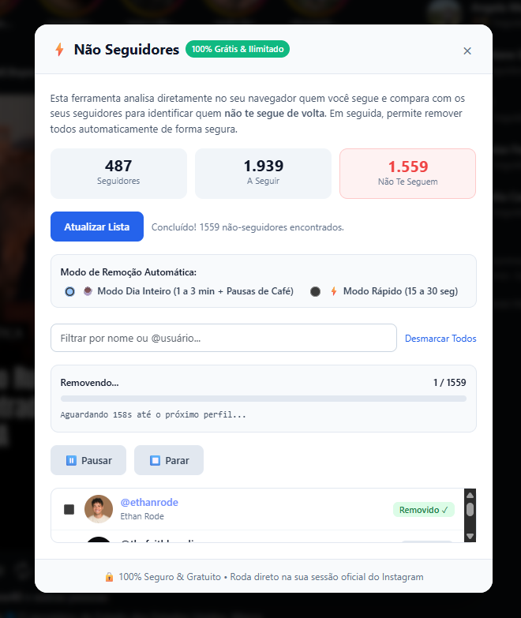

# ⚡ Não Seguidores Grátis - Instagram Unfollower Pro

> **Extensão para Google Chrome open-source, 100% gratuita, sem limites, sem anúncios e com proteção anti-bloqueio para Instagram.**

Identifique instantaneamente quem você segue e não te segue de volta no Instagram e deixe de seguir todos com segurança, sem precisar comprar versões "Pro" de ferramentas de terceiros e sem fornecer sua senha a ninguém.

---

## 📸 Demonstração da Interface



---

## 🚀 Principais Funcionalidades

- **🔍 Escaneamento Automático com 1 Clique:** Analisa seguidores e quem você segue diretamente na sua sessão oficial do Instagram, sem que você precise digitar ou colar listas.
- **🛡️ Algoritmo Anti-Bloqueio (Modo Dia Inteiro):** Simula pausas humanas realistas com intervalos de 1 a 3 minutos entre perfis e **Pausas para Café automáticas de 10 a 20 minutos** a cada lote de 10 contas.
- **⚡ Modo Rápido:** Intervalo de 15 a 30 segundos para remoções menores.
- **🎯 Controle Total:**
  - Barra de busca instantânea para filtrar amigos ou perfis específicos.
  - "Selecionar Todos" ou "Desmarcar Todos".
  - Desmarque quem você quer continuar seguindo.
  - Botão de **Pausar** e **Parar** a qualquer momento.
- **🔒 Privacidade Absoluta:** O código roda 100% localmente no seu computador. Nenhuma credencial, cookie ou informação pessoal é enviada para nenhum servidor externo.
- **💎 100% Gratuito & Ilimitado:** Sem paywalls, sem assinaturas e sem pop-ups mandando você comprar versão "Pro".

---

## 🆚 Comparativo: Outras Ferramentas vs Este Projeto

| Recurso | Ferramentas Tradicionais (ex: Invertexto) | **Não Seguidores Grátis** |
| :--- | :---: | :---: |
| **Identificar Não-Seguidores** | ✅ Sim | ✅ **Sim (Instantâneo)** |
| **Remoção em Massa** | ❌ Exige pagar versão "Pro" | ✅ **100% Grátis & Ilimitado** |
| **Pausas de Segurança Humanas** | ⚠️ Básico ou Manual | ✅ **Automático + Pausas de Café** |
| **Código Aberto & Transparente** | ❌ Não (Código fechado) | ✅ **Sim (Open Source)** |
| **Anúncios ou Banners de Venda** | ⚠️ Vários banners promocionais | 🚫 **Zero Anúncios** |

---

## 🛠️ Como Instalar no seu Navegador (Chrome, Edge, Brave, Opera)

Como a extensão é de código aberto, você pode instalá-la em modo desenvolvedor em menos de 1 minuto:

1. Baixe ou clone este repositório no seu computador:
   ```bash
   git clone https://github.com/SEU-USUARIO/instagram-unfollower-extension.git
   ```
2. Abra o Google Chrome (ou Edge/Brave) e acesse:
   ```text
   chrome://extensions/
   ```
3. No canto superior direito, **ative o "Modo do desenvolvedor"** (*Developer mode*).
4. No canto superior esquerdo, clique em **"Carregar sem compactação"** (*Load unpacked*).
5. Selecione a pasta do projeto baixado (`instagram-unfollower-extension`).
6. Pronto! O ícone ⚡ aparecerá na barra de extensões do seu navegador.

---

## 📖 Como Usar

1. Acesse o [Instagram](https://www.instagram.com) no seu navegador (já logado na sua conta).
2. Clique no ícone do **Não Seguidores Grátis** na barra do Chrome.
3. Clique em **"🔍 Carregar Não-Seguidores"**.
4. Quando a lista carregar, selecione as contas que deseja remover (ou use o botão "Selecionar Todos").
5. Escolha o **Modo Dia Inteiro** (Recomendado) e clique em **"🚀 Deixar de Seguir Selecionados"**.
6. Deixe a aba aberta em segundo plano e continue usando seu computador normalmente!

---

## ⚖️ Aviso Legal / Disclaimer

Este projeto foi desenvolvido para fins educacionais e de produtividade pessoal. Não é afiliado, patrocinado ou endossado pela Meta Platforms, Inc. ou pelo Instagram. Use com responsabilidade respeitando as diretrizes de uso da plataforma.

---

## 📄 Licença

Distribuído sob a licença [MIT](LICENSE). Sinta-se à vontade para utilizar, modificar e contribuir!
